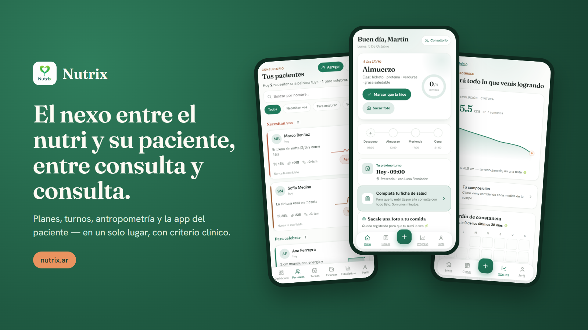
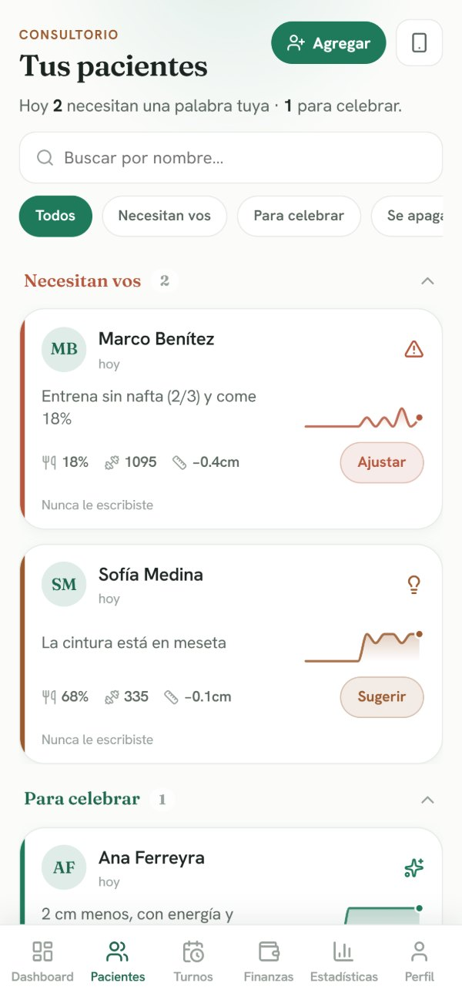
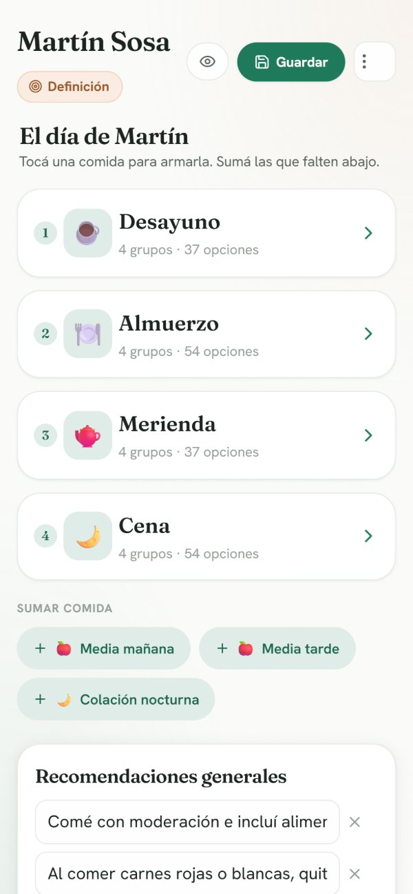
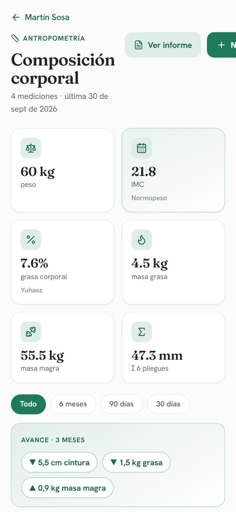
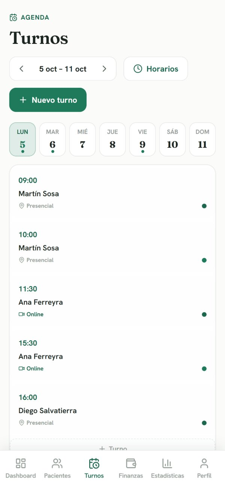
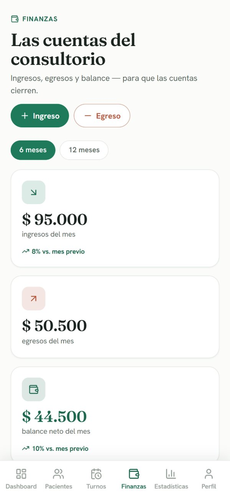
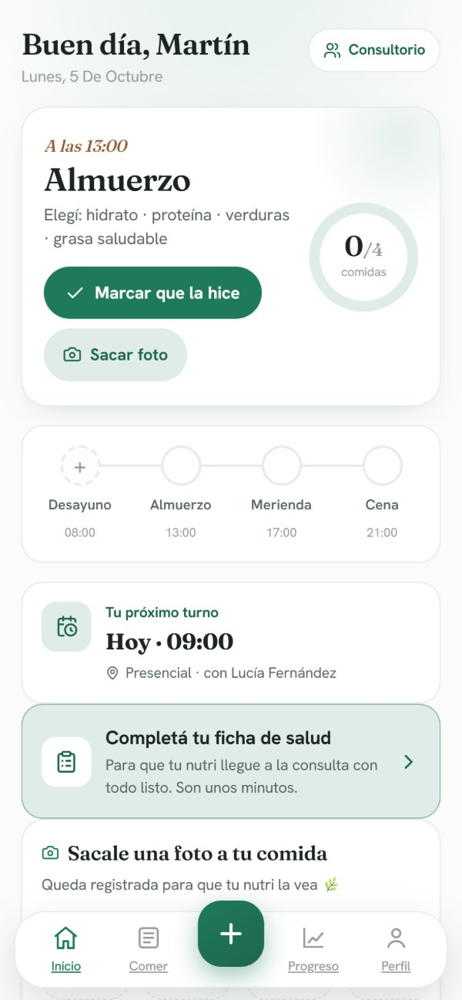
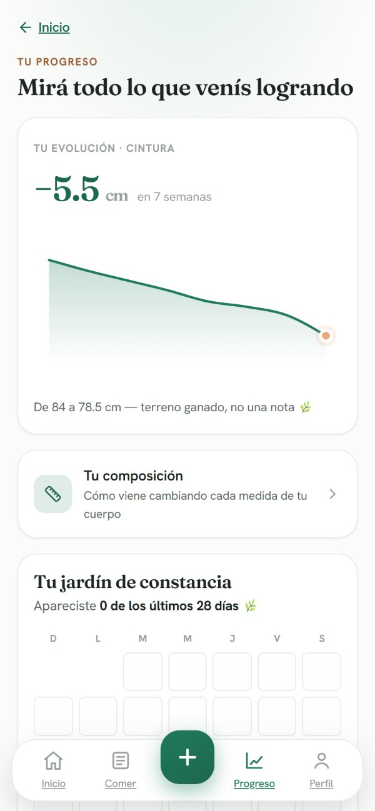
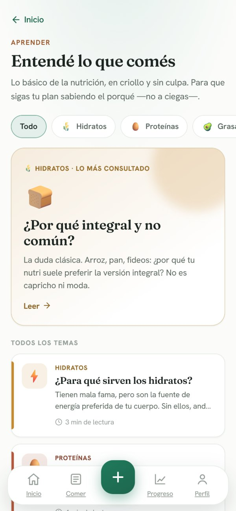
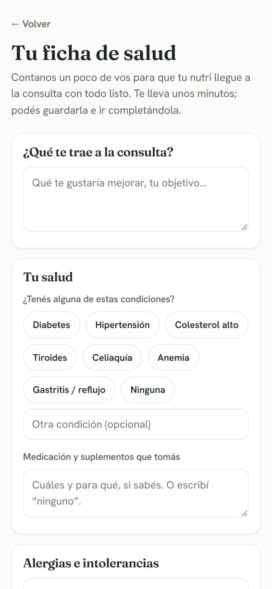

  

  <a href="https://nutrix.ar"><b>nutrix.ar</b></a> ·
  <a href="#qué-resuelve">Qué resuelve</a> ·
  <a href="#para-el-nutricionista">Nutricionista</a> ·
  <a href="#para-el-paciente">Paciente</a> ·
  <a href="#cómo-está-construido">Cómo está construido</a>

---

**Nutrix** es una app para nutricionistas y sus pacientes. Al profesional le resuelve el día a día del consultorio: planes, turnos, antropometría y cobros. Al paciente le da una app simple para seguir su plan entre consulta y consulta.

> Estado: **beta**. Este repositorio es una vidriera del producto. El código fuente es privado.

## Qué resuelve

En nutrición, lo que define el resultado pasa **entre consultas**: las semanas en las que el paciente está solo con su plan. Ahí es donde se pierde la motivación, aparecen las dudas y muchos abandonan.

Nutrix está pensado para ese tiempo intermedio:

- **El paciente** tiene su plan en el bolsillo, registra lo que come con una foto, ve su progreso y aprende el porqué de lo que come.
- **El nutricionista** ve quién necesita una palabra y quién merece una felicitación, sin tener que perseguir a cada paciente.
- **El consultorio** deja de depender de planillas, PDFs y chats sueltos.

## Para el nutricionista

<table>
  <tr>
    <td align="center" width="33%"> <b>Pacientes con triage</b> quién necesita una palabra tuya hoy y quién merece una felicitación</td>
    <td align="center" width="33%"> <b>Editor de planes</b> el día del paciente, comida por comida, con grupos e intercambios</td>
    <td align="center" width="33%"> <b>Antropometría</b> mediciones, composición corporal y evolución en el tiempo</td>
  </tr>
  <tr>
    <td align="center"> <b>Agenda</b> turnos presenciales y online, con confirmación de ambos lados</td>
    <td align="center"> <b>Finanzas</b> ingresos, egresos y balance del consultorio</td>
    <td></td>
  </tr>
</table>

Además:

- **Alta de pacientes por invitación.** El nutri manda un link por WhatsApp y el paciente crea su cuenta ya vinculada al consultorio.
- **Ficha de admisión que completa el paciente.** El nutri llega a la primera consulta con la anamnesis hecha.
- **Diario fotográfico de comidas.** Las fotos del paciente llegan a una galería en su ficha.

## Para el paciente

<table>
  <tr>
    <td align="center" width="25%"> <b>Su día</b> la próxima comida, qué elegir y un toque para marcarla o sacarle una foto</td>
    <td align="center" width="25%"> <b>Progreso</b> evolución de medidas y constancia, contadas como terreno ganado</td>
    <td align="center" width="25%"> <b>Aprender</b> nutrición en criollo y sin culpa, para seguir el plan sabiendo el porqué</td>
    <td align="center" width="25%"> <b>Ficha de salud</b> se completa antes de la consulta, a su ritmo</td>
  </tr>
</table>

## Principios de diseño

- **Pensado para el celular.** El nutri trabaja entre consultas y el paciente vive con el teléfono en la mano. Cada pantalla se diseña primero para el móvil.
- **Cuidado con la relación con la comida.** Nada de rankings, rachas que castigan ni lenguaje de culpa. El progreso se muestra como terreno ganado, no como una nota. El contenido educativo está escrito para no disparar conductas de riesgo.
- **El criterio clínico es del nutricionista.** La app acompaña y ordena, pero no prescribe ni reemplaza al profesional. El contenido para el paciente siempre remite a su nutri.
- **Cálido, no clínico.** Una estética verde y orgánica, con tipografía editorial (Fraunces + Hanken Grotesk), lejos del look de planilla o de "app de IA".

## Cómo está construido

| Capa | Tecnología |
|---|---|
| Frontend | Next.js · React · TypeScript · visx (gráficos) · Motion |
| Backend | Node.js · Fastify · Prisma |
| Datos | PostgreSQL multi-tenant con Row Level Security · Redis |
| Archivos | Almacenamiento S3-compatible |
| Infraestructura | Docker · Caddy · self-hosted |

Algunas decisiones de fondo:

- **Aislamiento por consultorio en la propia base de datos.** Cada consultorio solo ve sus datos porque lo impone PostgreSQL con Row Level Security, no solo el código de la aplicación.
- **Datos de salud tratados como datos sensibles.** Sesiones del lado del servidor y revocables, contraseñas con argon2id y acceso mínimo por rol.
- **Costos bajos a propósito.** Todo el stack es open source y self-hosted, para que el precio para el profesional pueda ser accesible.

## Contacto

Desarrollado por [@romerojorgectes](https://github.com/romerojorgectes).
¿Sos nutricionista y querés probarlo? Entrá a **[nutrix.ar](https://nutrix.ar)**.

---

© 2026 Nutrix. Todos los derechos reservados. Las capturas usan datos ficticios.
